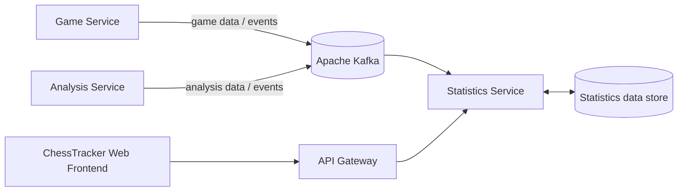

<div align="center">

# 📊 ChessTracker Statistics Service

### Performance analytics, playing patterns, and the AI-generated Chess Portrait.

[](https://openjdk.org/)
[](https://spring.io/projects/spring-boot)
[](https://www.postgresql.org/)
[](https://kafka.apache.org/)

[← ChessTracker](https://github.com/illia-krupko/chess-tracker) · [Game Service](https://github.com/illia-krupko/chess-tracker-game-service) · [Analysis Service](https://github.com/illia-krupko/chess-tracker-analysis-service)

</div>

---

## 📊 Responsibility

Statistics Service owns the player-statistics domain in ChessTracker. It brings together game outcomes and analysis-derived data into a statistics-oriented view, keeping aggregate queries separate from the transactional game API.

This service provides a dedicated boundary for player analytics rather than making Game Service calculate every statistic during an ordinary game request. Its goal is to turn game history and engine-analysis data into both measurable performance indicators and a readable picture of how a player approaches chess.

## ✨ Statistics domain

- **Game activity:** total games and activity summaries.
- **Results overview:** wins, draws, losses, and performance splits.
- **Playing patterns:** results by colour, openings, and other game attributes.
- **Progress tracking:** rating and results trends over time, when rating data is available.
- **Engine-derived metrics:** average accuracy, brilliant-move counts, and other indicators supported by game analysis.
- **Performance trends:** compare a player’s results and analysis metrics across games and time periods.
- **Chess Portrait:** an AI-generated description of the player’s style, a concise style label, and a comparison to a well-known player with a similar style.
- **Read-oriented API:** statistics, performance dashboards, and player-profile data delivered through the ChessTracker API boundary.

## ♟️ Chess Portrait: a player’s chess identity

Chess Portrait is a signature player-profile feature built on top of the statistics domain. Instead of showing numbers alone, it uses them as evidence for a concise, understandable description of how the player tends to play.

The portrait has three parts:

1. **Playing-style summary** — recurring tendencies, strengths, and characteristic decisions, described in plain language.
2. **Style label** — a short classification such as *Attacking Player*, *Positional Defender*, or another label supported by the player’s games.
3. **Similar-player comparison** — a well-known chess player whose style resembles the user’s, accompanied by the specific similarities that informed the comparison.

The AI can interpret aggregate statistics and, where useful, several games from different periods to capture how a player’s style changes over time. Stockfish remains responsible for engine evaluation; the language model interprets the evidence and explains patterns. A similarity to a famous player is a stylistic comparison, not a comparison of playing strength.

## 🏗️ Position in the system



Statistics Service is separated from Game Service so statistics calculations and query models have their own lifecycle. It turns game and analysis data into performance metrics and Chess Portrait inputs, while the frontend presents those insights in the player dashboard. Event-driven integration keeps the statistics view decoupled from game writes.

## 🛠️ Technology stack

- Java 21 · Spring Boot 4.1.1
- Spring Web MVC · Spring Security · Validation
- Spring Data JPA / Hibernate
- PostgreSQL · Liquibase
- Apache Kafka
- Gradle
- JUnit · Spring Boot test support · Testcontainers

## 🧮 Core metrics

| Metric group | Examples |
|---|---|
| Game outcomes | Win/draw/loss rates, including splits by colour or opening |
| Engine performance | Average accuracy, brilliant-move counts, and other analysis-derived indicators |
| Playing tendencies | Results and performance by game situation or recurring pattern |
| Progress | Changes in results and analysis metrics over time |
| Chess Portrait | AI-generated style summary, style label, and similar-player comparison |

The exact set of metrics depends on the available game and engine data. Each metric should have a clear calculation rule so results remain consistent across the product.

## 🧮 Data and calculation principles

- Keep statistics data owned by Statistics Service rather than querying another service's database directly.
- Define metrics with clear rules so the same dataset produces consistent results.
- Make event processing safe against duplicate delivery.
- Keep expensive aggregation out of latency-sensitive game operations.
- Preserve enough source information to recalculate derived metrics when rules change.

## 🚀 Run locally

### Prerequisites

- JDK 21
- PostgreSQL and Kafka from [ChessTracker Infrastructure](https://github.com/illia-krupko/chess-tracker-infrastructure)
- Service configuration for the required database, broker, and trusted Gateway path

From this repository root:

```bash
./gradlew clean build
./gradlew bootRun
```

The application's Spring configuration is in `src/main/resources/application.yaml`. Configure database, Kafka, and security settings to match the local environment before connecting it to the rest of ChessTracker.

## 🖥️ Frontend integration

Statistics Service supplies structured player statistics and profile data for the ChessTracker web frontend. The UI can present numeric metrics as dashboards and trends, then display the Chess Portrait as a human-readable summary of the patterns behind those numbers. The service owns calculations and data interpretation inputs; presentation remains a frontend responsibility.

## 🔗 Related repositories

[ChessTracker](https://github.com/illia-krupko/chess-tracker) · [Game Service](https://github.com/illia-krupko/chess-tracker-game-service) · [Analysis Service](https://github.com/illia-krupko/chess-tracker-analysis-service) · [User Service](https://github.com/illia-krupko/chess-tracker-user-service) · [API Gateway](https://github.com/illia-krupko/chess-tracker-api-gateway) · [Infrastructure](https://github.com/illia-krupko/chess-tracker-infrastructure)
